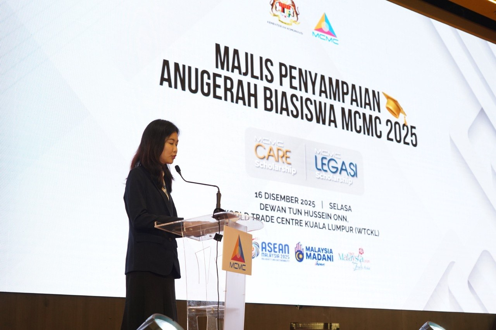
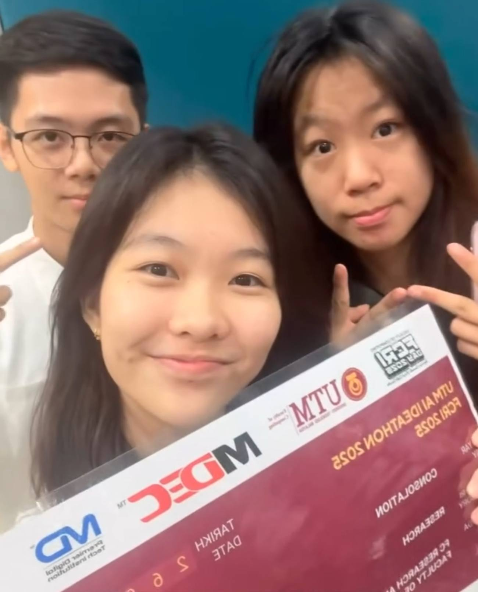
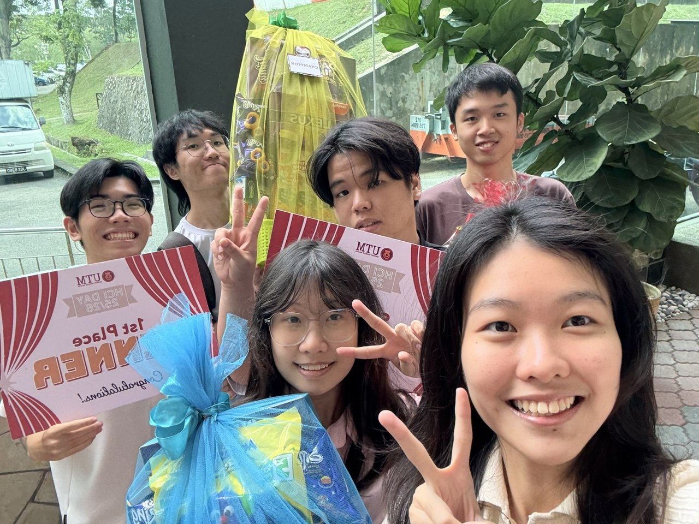
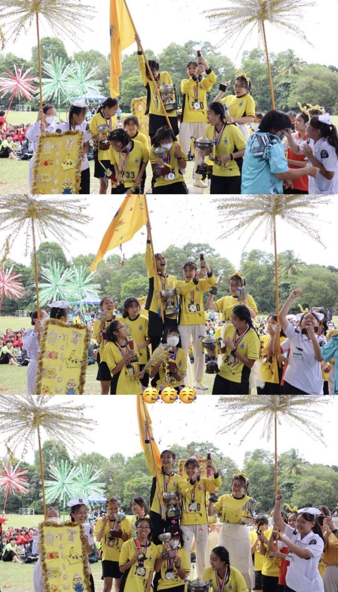

# Hi, I'm Jia Yie 👋

### Computer Network & Security student · Universiti Teknologi Malaysia

*Curious about technology. Inspired by people. Always learning.*

---

### 🌷 A little about me

I'm **Tan Jia Yie**, a Computer Network and Security student at **UTM** who enjoys discovering how technology works and turning ideas into useful projects.

- 🌱 Learning through coursework, team projects, and hands-on exploration.
- 🔐 Interested in computer networks, security, and building thoughtful applications.
- 🎧 Usually accompanied by music — always open to a new genre.
- 🌍 Happy to explore something new, whether it's food, culture, or technology.
- 💬 Pronouns: **she/her**.

### ✨ Honours & highlights

| Recognition | My journey |
| :--- | :--- |
| 🎓 **MCMC CARE Scholarship** | Scholarship recipient and recipient representative delivering a speech at the **MCMC Scholarship Award Ceremony 2025**. |
| 💡 **Ideathon · Consolation Prize** | Collaborated with my team to develop and present our idea. |
| 🏆 **HCI Day · Champion** | Celebrated a championship with my HCI project team. |
| 🥇 **Team Championship · Leadership** | Led my team to become champions — a proud moment of teamwork and shared effort. |

  
   
  🎤 Representing fellow scholarship recipients at the MCMC Scholarship Award Ceremony 2025.

<table>
  <tr>
    <td align="center" width="50%">
       
      <b>💡 Ideathon · Consolation Prize</b> 
      From an idea to a shared achievement.
    </td>
    <td align="center" width="50%">
       
      <b>🏆 HCI Day · Champion</b> 
      Building, presenting, and winning together.
    </td>
  </tr>
</table>

<b>🥇 Leading my team to a championship</b>

 

   
  A championship made possible by teamwork, commitment, and the joy of leading together.

### 🚀 Project highlights

| Project | What it's about | Explore |
| :--- | :--- | :--- |
| 🌱 **LumiCare · Never404** | A team project connecting student workload and wellbeing through an AI companion, workload visualisation, and recovery activities. | [Repository](https://github.com/tanjiayie/Never404) · [Demo](https://youtu.be/TIDQp86_KFI) |
| 🏨 **Smart Room Booking System** | A collaborative Java project for room reservations, with a package-based structure and command-line execution. | [Repository](https://github.com/tanjiayie/Meeting-Room-Reservation-System) |
| 🗂️ **Technology & Information System** | SECP1513 coursework covering PC assembly, industry talks and visits, academic writing, and design thinking. | [Course portfolio](https://github.com/miqbaltariq/SECP1513202420251/tree/6712538f112c0b22242a1f5d865f95c017d300b8/06/TAN%20JIA%20YIE) |

### 🛠️ My toolkit

  
  
  
  

### 🏅 Beyond the code

I enjoy being part of a team, both in projects and on the sports field.

- Represented my school in **high jump, ping pong**, and other sports.
- Built **four years of sports leadership experience** in secondary school.
- Participated in leadership camps and student activities.

<b>📚 Academic milestones</b>

 

| Milestone | Result |
| :--- | :--- |
| SPM | 10A |
| Foundation | CGPA 3.97 |
| MUET | Band 4.0 |
| UPSR | 7A |

<b>📷 A few memories</b>

 

  
  &nbsp;
  

---

### 🎵 Viva la vida!

*Keep learning, stay curious, and enjoy the little things.*

Thanks for stopping by 🌷

